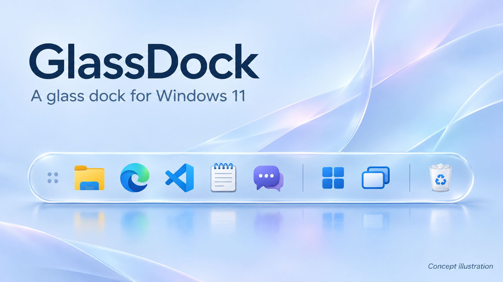

# Windows 11 GlassDock — mac UI

*글래스독의 디자인 방향을 담은 소개용 일러스트입니다. 실제 실행 화면과 아이콘 구성은 다를 수 있습니다.*

**익숙한 Windows에 투명한 유리 독과 부드러운 창 미리보기를 더합니다.**

GlassDock은 Windows 11에서 실행하는 개인용 데스크톱 독입니다. macOS에서 영감을 받은 간결한 외형과 모션을 바탕으로, 실행 중인 앱을 모으고 필요한 창으로 돌아가는 과정을 편하게 만드는 데 초점을 두었습니다.

탐색기와 브라우저, 각 프로그램의 내부 화면과 키보드 사용 방식은 그대로 유지합니다. 반투명 유리 표면 위에 실제 앱 아이콘을 배치하고, 마우스를 올리면 해당 앱의 창을 둥근 카드로 미리 볼 수 있습니다.

## 주요 기능

| 기능 | 소개 |
|---|---|
| 투명한 유리 재질 | 뒤 화면이 은은하게 비치는 흐림 효과와 얇은 테두리, 부분 반사광 |
| 실제 앱 아이콘 | 실행 중인 프로그램 자동 표시, 자주 쓰는 앱 고정, 순서 저장 |
| 실시간 창 미리보기 | 마우스를 올리면 둥근 미리보기 카드 표시, 클릭하면 창 선택 |
| 창 선택과 복원 | 전체 창 보기, 앱 창 최소화·복원, Windows 작업 보기 호출 |
| 원하는 위치에 배치 | 상·하·좌·우 가장자리 배치, 모니터 선택, 자동 숨김 |
| 앱·도구 구역 정리 | 앱 순서를 바꾸고 도구 구역에도 배치, 마지막에는 실제 Windows 휴지통 |
| 지니 최소화 효과 | 창이 휘어지며 독으로 들어가고 반대로 나오는 macOS 스타일 효과, 아이콘/썸네일 방식과 속도 선택 |

## 시작하기

Windows 11 x64에서 사용합니다. .NET 런타임이 포함되어 있어 별도로 설치할 필요가 없습니다.

1. **Code → Download ZIP**으로 저장소를 내려받고 압축을 풉니다.
2. `windows11 glass dock mac UI/portable/GlassDock-win-x64.zip`도 압축을 풉니다.
3. 기존 GlassDock이 켜져 있다면 종료한 후 `GlassDock.exe`를 실행합니다.

소스를 직접 수정하려면 Windows와 .NET 8 SDK 이상이 필요합니다. 자세한 사용·빌드 방법은 아래 실행 안내를 참고하세요.

실행 안내와 파일은 [windows11 glass dock mac UI](windows11%20glass%20dock%20mac%20UI/README.md) 폴더에 있습니다.

버전별 수정·적용 사항은 [Release Notes](Release%20Notes/README.md)에 기록했습니다. 현재 독 버전은 **0.3.0**입니다.

## 현재 배포 범위

이 저장소에는 독 실행용 ZIP, C# WPF 소스와 빌드 도구가 있습니다. 별도로 개발한 상단 바는 현재 배포 파일에 포함하지 않았습니다. AI 앱은 일반 앱처럼 고정해 사용하며, 독 내부 AI 채팅은 제공하지 않습니다.

개인 개발 빌드입니다. 현재 PC에서 사용한 실행본을 배포하며, 모든 앱·모니터·배율 조합과 다른 PC의 동작까지 확인한 것은 아닙니다. 최소화되거나 보호된 창의 영상은 Windows와 원본 앱의 상태에 따라 제한될 수 있습니다.
