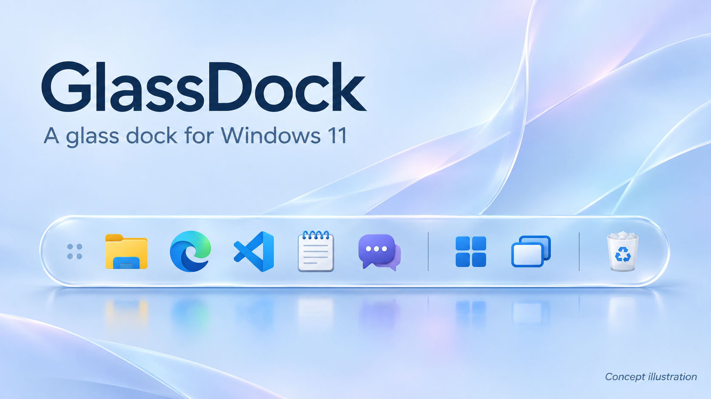

# Windows 11 GlassDock — mac UI

[버전별 Release Notes](../Release%20Notes/README.md) · [현재 0.2.1 변경 사항](../Release%20Notes/Release%20Note0.2.1%20ver.md)

*실제 실행 화면이 아닌 소개용 일러스트입니다.*

## GlassDock 소개

GlassDock은 익숙한 Windows에 유리 재질의 독과 부드러운 창 미리보기를 더하는 개인용 데스크톱 도구입니다. macOS에서 영감을 받은 외형을 사용하면서 탐색기·브라우저와 각 앱의 내부 화면, 키보드 사용 방식은 그대로 유지합니다.

실행 중인 앱을 한곳에 모으고 자주 쓰는 앱을 고정할 수 있습니다. 아이콘에 마우스를 올리면 둥근 실시간 미리보기로 창을 확인하고, 클릭해 해당 창으로 이동합니다. 저장된 아이콘 순서, 전체 창 보기, 가장자리 배치와 자동 숨김, 실제 Windows 휴지통도 제공합니다.

독은 32 DIP 실제 앱 아이콘을 중심으로 작게 구성하며, 뒤 화면이 은은하게 비치는 유리 배경과 얇은 반사광으로 표현합니다. 별도로 개발한 상단 바와 독 내부 AI 채팅은 이 배포본에 포함하지 않습니다.

Windows 11 x64용 유리 효과 독입니다. 현재 PC에서 실행 중인 `완성본 ex1/실행파일/GlassDock.exe`와 해당 배포본의 소스를 정리했습니다.

## 다운로드와 실행

1. 이 저장소에서 **Code → Download ZIP**을 선택하고 압축을 풉니다.
2. `windows11 glass dock mac UI/portable/GlassDock-win-x64.zip`의 압축을 풉니다.
3. 기존 GlassDock이 실행 중이면 종료한 뒤, 압축을 푼 `GlassDock.exe`를 실행합니다.

.NET 런타임이 포함되어 있어 별도 .NET 설치는 필요하지 않습니다. 현재 PC에서 사용 중인 기존 실행 파일을 그대로 압축했으며, 다른 PC에서의 실행은 이번 업로드에서 검증하지 않았습니다.

## 포함 파일

- `portable/GlassDock-win-x64.zip`: 런타임 포함 단일 실행 파일. 원본 EXE는 약 188MB이므로 ZIP으로 제공합니다.
- `source/`: C# WPF 소스, 테스트, 빌드 도구, 기존 구현 문서.
- `SHA256SUMS.txt`: 실행 파일과 실행용 ZIP의 SHA-256.

개인 설정 백업, 실행 로그, 서명용 개인 키, 예전 중복 배포본은 포함하지 않았습니다. 상단 바는 독과 별도의 프로그램이며 이 패키지에 포함하지 않았습니다.

## 설정과 종료

설정은 `%LOCALAPPDATA%\GlassDock\settings.json`에 저장됩니다. 새 PC에서는 기본 설정으로 시작합니다. 독 손잡이 우클릭 또는 트레이 메뉴에서 종료할 수 있습니다. 자동 시작은 등록하지 않습니다.

## 소스 빌드

Windows와 .NET 8 SDK 이상이 필요합니다. PowerShell에서 `source` 폴더로 이동해 `./build.ps1`을 실행합니다. 최초 복원에는 인터넷 연결이 필요할 수 있습니다. 기본 빌드는 캡처 테두리 숨김 권한이나 인증서 설치를 요청하지 않습니다.

기존 `source/README_KO.md`와 인수인계 문서에는 과거 버전과 예전 산출물 경로도 남아 있습니다. 이 업로드의 실행 파일 위치와 실행 방법은 위 안내를 기준으로 합니다.
